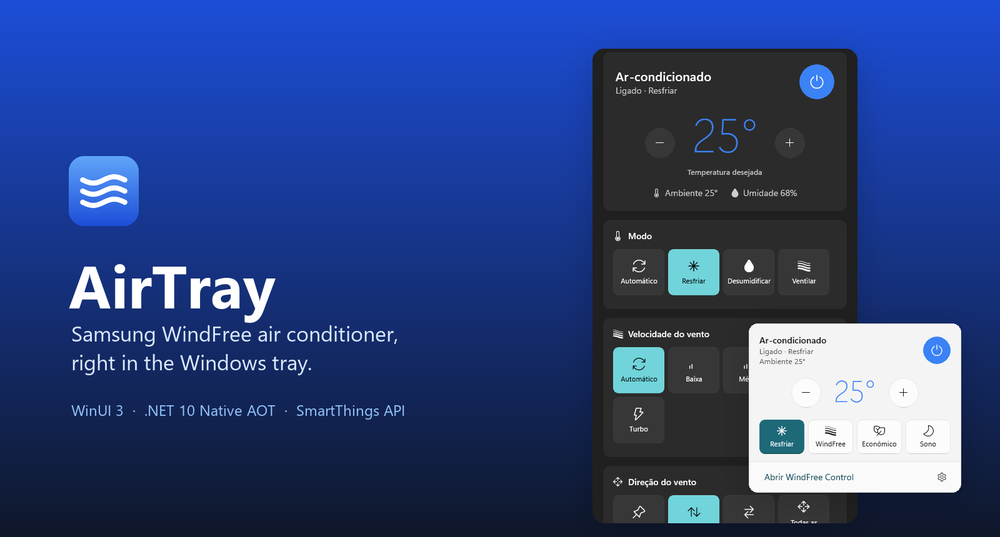
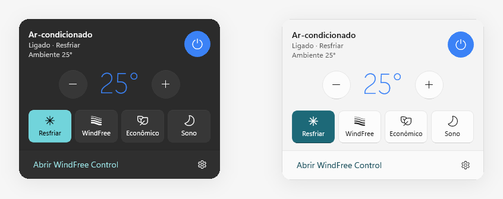
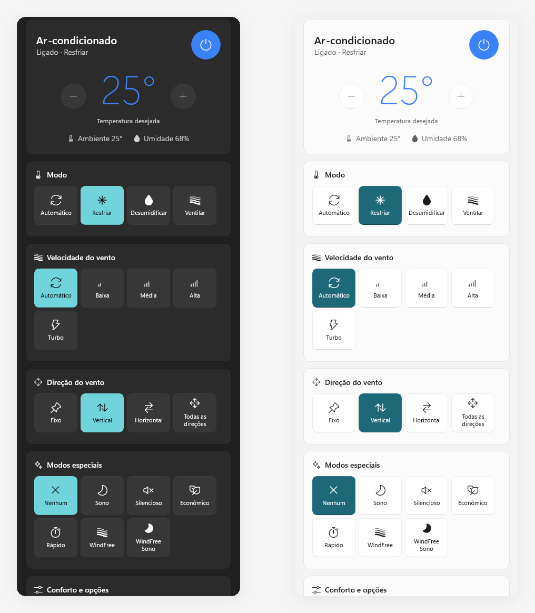
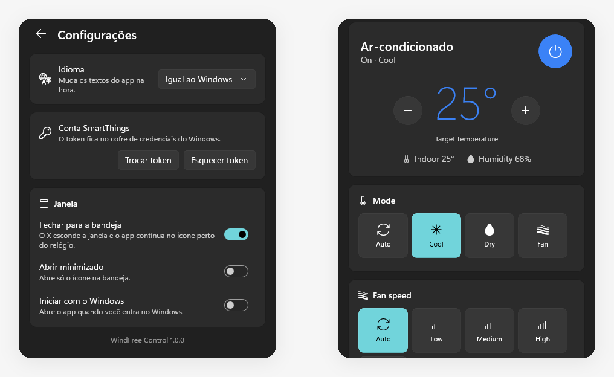

<p align="center">
  
</p>

<p align="center">
  <a href="https://github.com/jpemendonca/AirTray/releases/latest"></a>
  
  
  
</p>

<p align="center">
  <a href="README.md">Read in English</a>
</p>

O **AirTray** é um app nativo e leve pra Windows que controla um ar-condicionado
**Samsung WindFree** pela nuvem do SmartThings. Abre na hora, fica na bandeja perto do relógio e
tem cara de app que veio com o Windows 11: Mica, tema claro e escuro, ícones Fluent, português e
inglês.

Fiz porque o app oficial do SmartThings no Windows vivia travando. O AirTray faz uma coisa só e não
atrapalha.

## O que ele faz

- **Painel na bandeja**: clique no ícone perto do relógio e tenha liga/desliga, temperatura e os
  quatro atalhos mais usados (Resfriar, WindFree, Econômico, Sono). Clicou fora, sumiu.
- **Todos os controles que o aparelho informa**: modo, velocidade e direção do vento, modos
  especiais (WindFree, WindFree Sono, Econômico, Silencioso, Rápido, Sono), noite tropical, sons,
  luz do display, limpeza automática.
- **Montado a partir do seu aparelho**: os botões vêm da lista de funções do próprio ar, e os
  limites são respeitados (no Econômico a mínima sobe pra 24 °C, e o "−" para ali).
- **Manutenção**: uso do filtro com zerar contador, autodiagnóstico, versão do firmware.
- **Jeito de app nativo**: instância única, lembra a posição da janela, fecha pra bandeja, pode
  iniciar com o Windows, segue o tema do sistema, troca de idioma na hora.
- **Privado**: o token do SmartThings fica no cofre de credenciais do Windows. Sem servidor, sem
  telemetria, só o seu PC conversando com o SmartThings.

<p align="center">
  
</p>

<p align="center">
  
</p>

<p align="center">
  
</p>

## Baixar e usar

1. Baixe o `AirTray-*-win-x64.zip` mais recente em
   [Releases](https://github.com/jpemendonca/AirTray/releases/latest) e extraia onde quiser.
2. Rode o `WindFreeControl.exe`. O exe não tem assinatura digital, então o SmartScreen pode avisar
   na primeira vez: clique em **Mais informações → Executar assim mesmo**.
3. Crie um token de acesso pessoal em
   [account.smartthings.com/tokens](https://account.smartthings.com/tokens) com as permissões de
   `Devices` (`r:devices:*` e `x:devices:*`), cole e clique em **Conectar**.

### Compatibilidade

Testado com um Samsung WindFree de parede (2021, módulo Wi-Fi `ARA-WW-TP1-22-COMMON`). Outros
ares Samsung no SmartThings devem funcionar, porque a interface é montada a partir do que o
aparelho informa, mas não foram testados. O app controla o primeiro ar-condicionado da conta.

## Por dentro

| | |
|---|---|
| Interface | WinUI 3 (Windows App SDK), sem pacote, fundos Mica e acrílico |
| Runtime | .NET 10 publicado com Native AOT (não precisa instalar o .NET) |
| Bandeja | Wrapper próprio de `Shell_NotifyIconW`, sem pacotes extras |
| API | SmartThings REST: `GET /devices`, `GET /devices/{id}/status`, `POST /devices/{id}/commands` |
| Dados | Token no cofre de credenciais, configurações em `%LocalAppData%\WindFreeControl\settings.json` |
| Processo | Feito com desenvolvimento orientado a agente: [AGENTS.md](AGENTS.md), [SPECS.md](SPECS.md), [ROADMAP.md](ROADMAP.md) |

## Compilar

Requisitos: Windows 10 1809+ x64, .NET 10 SDK e, pro Native AOT, as "Ferramentas de Build do
MSVC x64" e o SDK do Windows 11 no Visual Studio.

```powershell
dotnet run --project src/WindFreeControl.App   # rodar
./gate.ps1                                     # formatação, build Release e testes
./publish.ps1                                  # build Native AOT em publish/
./publish.ps1 -NoAot                           # sem as ferramentas MSVC (maior, ReadyToRun)
./tools/install-shortcut.ps1                   # atalho no Menu Iniciar
```

O modo demo (`--demo`) e as ferramentas estão descritos no [README em inglês](README.md#demo-mode).

## Aviso

Projeto pessoal, sem vínculo com a Samsung. Samsung, WindFree e SmartThings são marcas da
Samsung Electronics.
